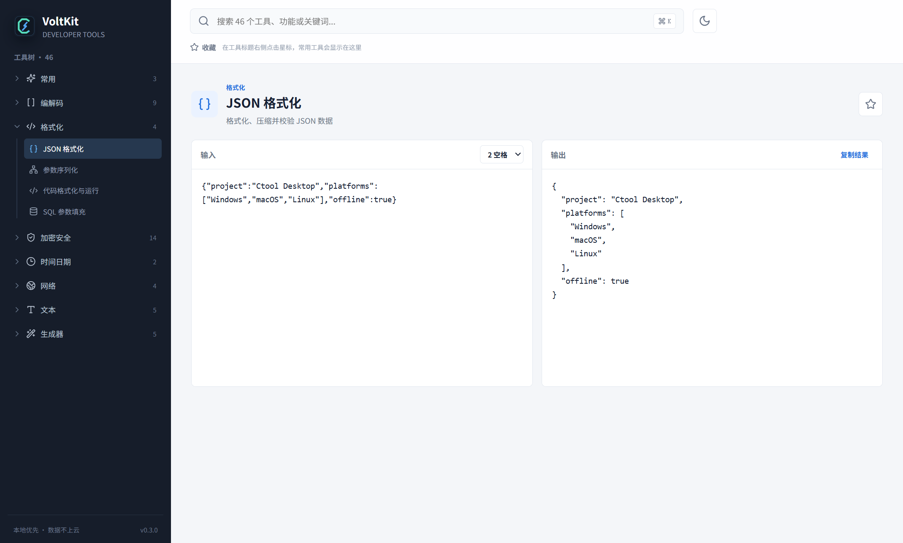
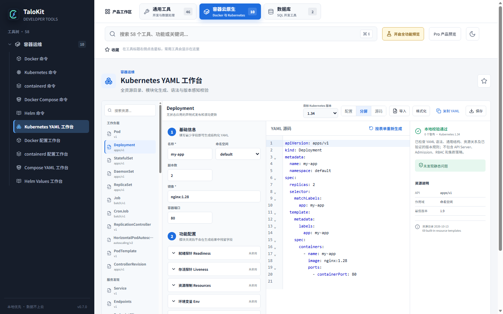
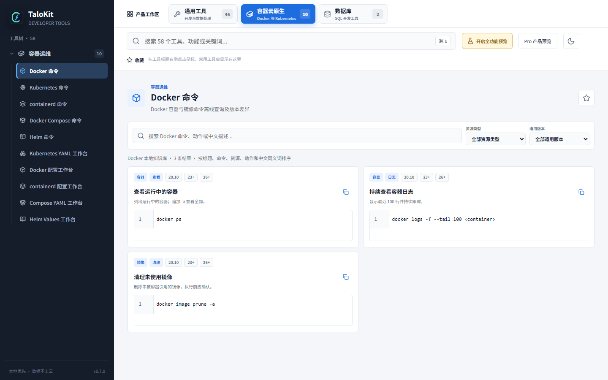
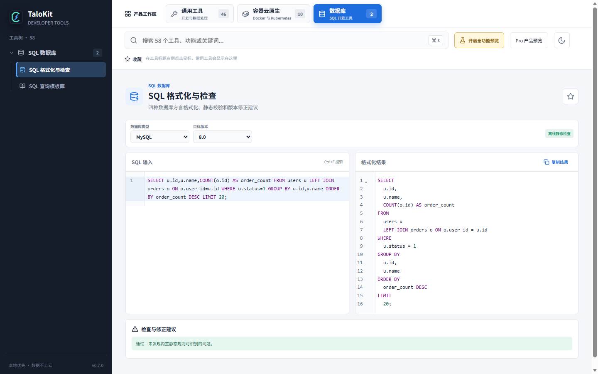
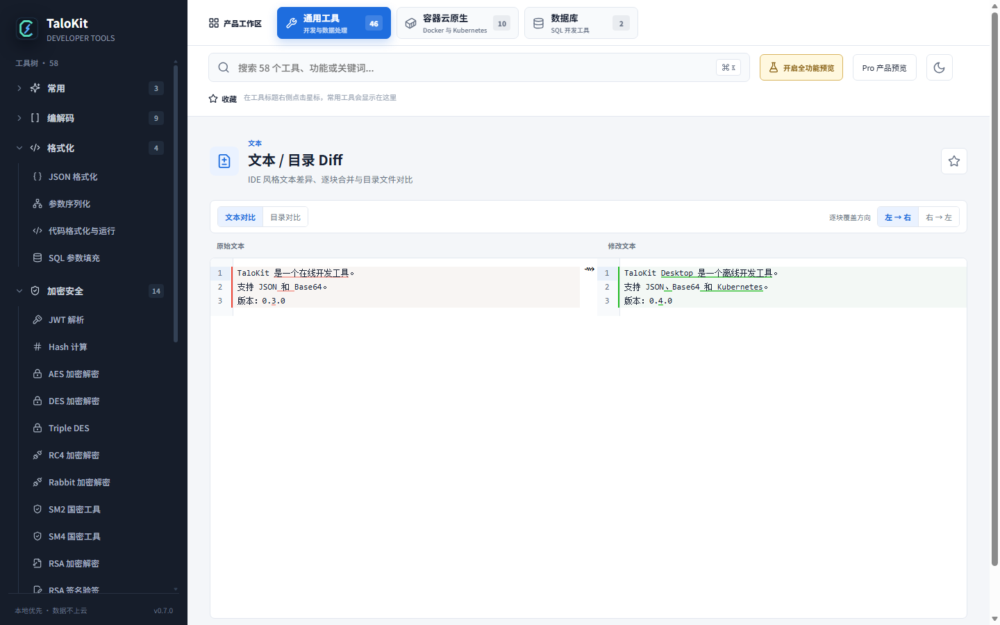

# TaloKit · Offline-first developer toolkit

<strong>Everyday developer tools. One desktop workspace. Local processing.</strong>

JSON, YAML, Base64, Hash, SQL, Diff, Docker, and Kubernetes utilities in one desktop app for Windows, macOS, and Linux.

  <a href="https://www.talokit.com/en/">Official website</a> ·
  <a href="https://www.talokit.com/#downloads">Download</a> ·
  <a href="docs/features.md">Features</a> ·
  <a href="docs/getting-started.md">Quick start</a> ·
  <a href="https://github.com/maningphp/talokit/issues">Report an issue</a> ·
  <a href="README.md">中文 README</a> ·
  <a href="https://www.talokit.com/contact/">Contact</a>

> This repository contains public product information, user documentation, and issue templates. It does not contain the TaloKit application source code.

  
  
  
  

**Looking for the latest version?** [Get the latest official installer](https://www.talokit.com/#downloads) · [GitHub Releases](https://github.com/maningphp/talokit/releases) · [Checksums and updates](docs/downloads.md). This repository does not automatically track desktop versions. If no Release is listed, use the official download section.

## Real product screenshots

These are existing official product screenshots, not interface mockups. Details may differ from the current release. The [JSON walkthrough](docs/json-and-base64.md) and featured workflows below show individual tools.

## Why TaloKit

- Keep frequently used developer tools in one searchable desktop workspace.
- Process most JSON, SQL, configuration, token, and text data locally.
- Use formatters, encoders, generators, static validators, and command references without a browser.
- Work on Windows, macOS, and Linux with x64 and ARM64 download options.
- Move beyond one-off converters with Kubernetes YAML, SQL analysis, and text/directory Diff workflows.

## Tool categories

| Category | Examples |
| --- | --- |
| Formatting and encoding | JSON, YAML, XML, TOML, Base64, URL, Unicode, Hex, Gzip |
| Security | Hash, HMAC, JWT, bcrypt, AES, DES, RSA, SM2, SM4 |
| Text and files | Regex, text transforms, naming conversion, text Diff, directory compare |
| Time and generators | Timestamps, time zones, Cron, UUID, random strings, QR codes, barcodes |
| Networking | IPv4/IPv6, CIDR, URL parsing, HTTP snippets, WebSocket assistance |
| SQL | MySQL, PostgreSQL, SQLite, and SQL Server formatting and static checks |
| Cloud native | Kubernetes YAML, kubectl, Docker, containerd, Compose, and Helm references |

See the [full feature map](docs/features.md).

## Featured workflows

### Kubernetes YAML workbench

Generate manifests by resource type and target Kubernetes version, including Deployment, Service, Ingress, ConfigMap, Secret, PVC, RBAC, and policy drafts. Edit with line numbers and run local syntax, field, compatibility, and engineering checks. Static validation cannot replace target-cluster API validation, CRD schemas, or admission policies; generated commands are not automatically executed.

[Kubernetes YAML workbench guide](docs/kubernetes-yaml.md)

### Container command library

Search kubectl, Docker, containerd, Compose, and Helm commands by resource, operation, task, version, alias, parameter, or troubleshooting intent. Potentially destructive commands include impact notes.

The command library explains, generates, and copies commands; it does not execute them on your machine.

[Container command library guide](docs/container-command-library.md)

### SQL formatting and static checks

Format MySQL, PostgreSQL, SQLite, and SQL Server statements, inspect risky patterns, and review version compatibility guidance. Static checks do not connect to production databases and cannot verify real schemas, permissions, or execution plans.

### Text and directory Diff

Compare text and files in two panes, navigate differences, and merge individual blocks. Directory comparison shows left-only, right-only, and changed files in a tree.

[SQL and Diff guide](docs/sql-and-diff.md)

## Getting started

1. Visit the [official download section](https://www.talokit.com/#downloads).
2. Select the package matching your operating system and CPU architecture.
3. Install TaloKit and use global search to open a tool or find a command.

See the [Chinese quick-start guide](docs/getting-started.md) for package selection and installation details.

## Free and Pro editions

| Edition | Intended use | Scope |
| --- | --- | --- |
| Free | Everyday development | JSON, encoding/decoding, time/date, text processing, basic formatters and generators |
| Pro annual | Frequent professional workflows | Professional tools and new professional capabilities during the subscription term |
| Pro lifetime | Long-term use | Professional features within the scope defined by the current purchase terms |

Professional tools primarily cover **Kubernetes and container operations, SQL tools, and text/file/directory Diff**. Common local tools such as JSON and basic YAML formatting, Base64, and Hash are in the free tool range. The current release and official licensing terms define the exact scope. Activation and license refresh require a network connection; the client shows the offline license validity period.

See [live pricing and current terms](https://www.talokit.com/#pricing). Device management follows the current account licensing rules.

## Privacy boundary

TaloKit is local-first, not inaccurately marketed as universally offline. Most formatting, conversion, generation, static validation, and reference tools run locally. Account registration, payment, licensing, update checks, IP lookup, WebSocket debugging, and user-requested network connections require network access.

[Privacy and data processing details](docs/privacy.md)

## FAQ

**Desktop app or online service?** TaloKit is a desktop application. Core local tools run on your machine; account, payment, licensing, and update services use the network.

**Are JSON, SQL, and YAML inputs uploaded?** Core formatting, conversion, and static validation do not upload inputs to third-party online tools for processing. Explicit network tools connect when their task requires it.

**Does the Kubernetes workbench change my cluster?** The YAML workbench and command library do not automatically apply manifests or execute generated commands. Validate against your target version, CRDs, and admission policies before applying.

**Where is the source code?** TaloKit is commercial software. This repository provides product information, public documentation, and support, not application source code.

See the [FAQ](docs/faq.md) for more answers.

## Documentation

Both READMEs cover the same product scope. Detailed guides below are currently in Chinese.

- [Installation and quick start](docs/getting-started.md)
- [Full feature map](docs/features.md)
- [JSON, YAML, and Base64 examples](docs/json-and-base64.md)
- [Tutorial index and editorial plan](docs/tutorials.md)
- [Kubernetes YAML workbench](docs/kubernetes-yaml.md)
- [Container command library](docs/container-command-library.md)
- [SQL and Diff](docs/sql-and-diff.md)
- [Privacy](docs/privacy.md)
- [Downloads, verification, and updates](docs/downloads.md)
- [FAQ](docs/faq.md)
- [Support](SUPPORT.md)

## Source availability

TaloKit is commercial desktop software and is not open source. This public repository is intentionally limited to product documentation, screenshots, support information, and issue tracking. Do not redistribute installers from unofficial mirrors.

## Links

- Website: <https://www.talokit.com/>
- English page: <https://www.talokit.com/en/>
- Downloads: <https://www.talokit.com/#downloads>
- Contact: <https://www.talokit.com/contact/>
- Issues: <https://github.com/maningphp/talokit/issues>

For bug reports or tool requests, use [GitHub Issues](https://github.com/maningphp/talokit/issues) and read the [feedback guidelines](CONTRIBUTING.md). Do not include passwords, tokens, private keys, production configurations, customer data, or unredacted logs.

TaloKit is maintained by Beijing Talo Technology Center.
