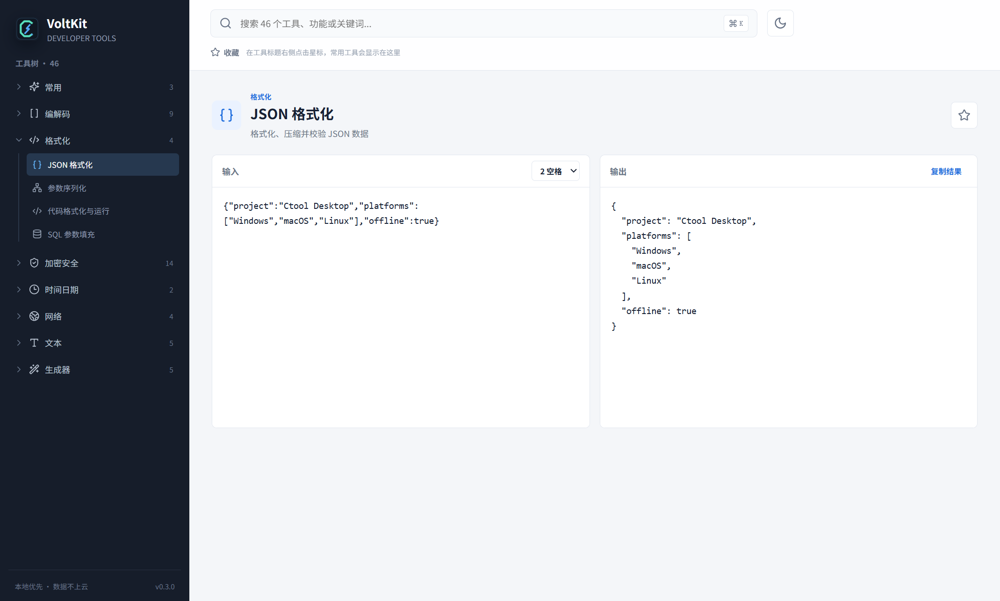
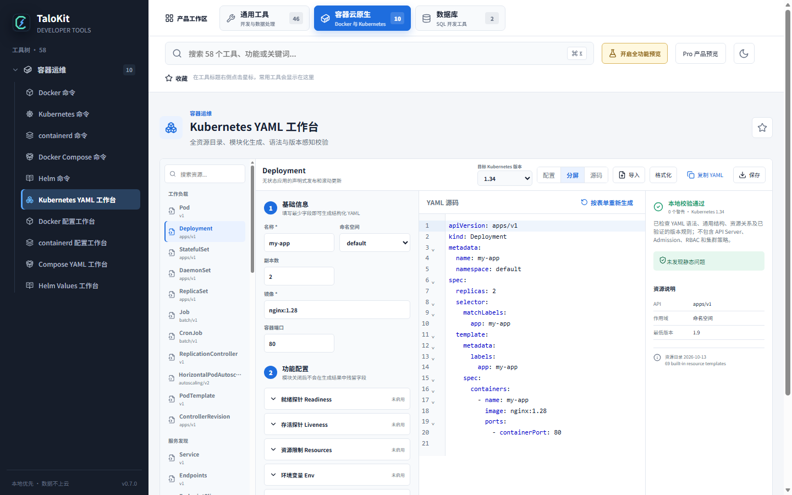
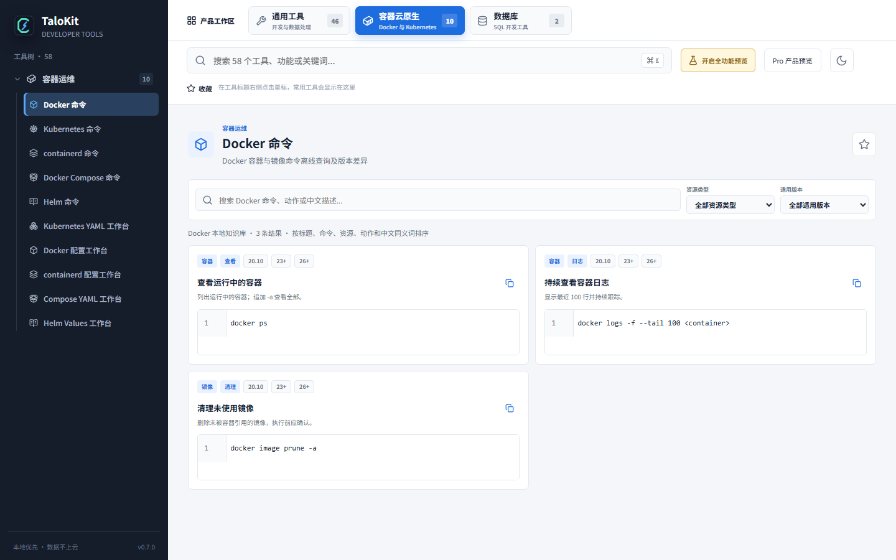
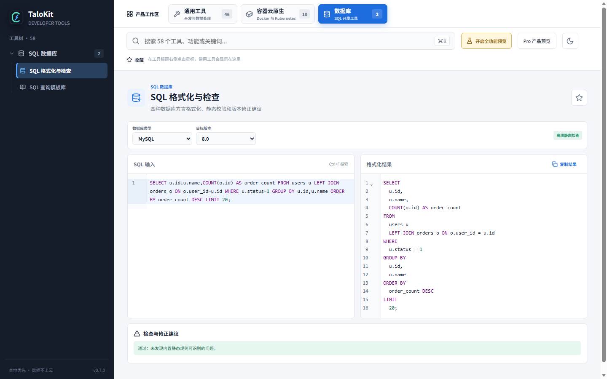
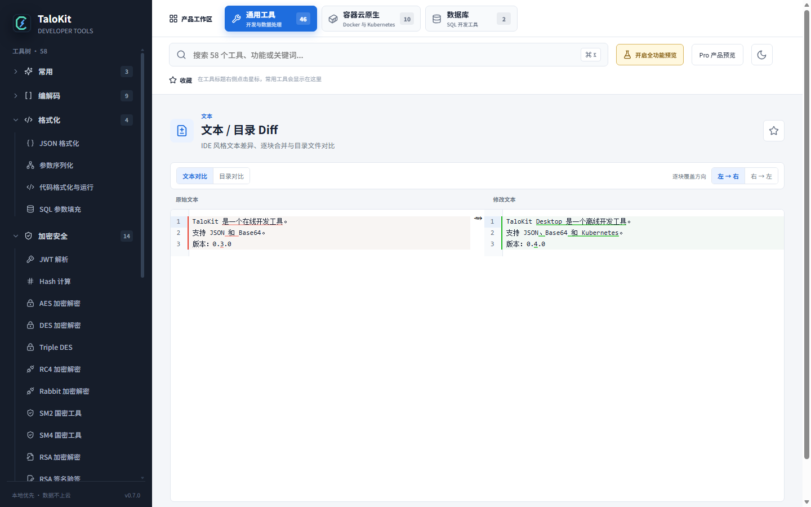

# TaloKit · 离线优先的跨平台开发者工具箱

  

<strong>常用开发工具，一次打开，本地处理。</strong>

  JSON、YAML、Base64、Hash、SQL、Diff、Docker、Kubernetes 等常用开发工具，集中在一个 Windows、macOS 和 Linux 桌面应用中。

  <a href="https://www.talokit.com/">官方网站</a> ·
  <a href="https://www.talokit.com/#downloads">下载 TaloKit</a> ·
  <a href="docs/features.md">功能介绍</a> ·
  <a href="docs/getting-started.md">快速开始</a> ·
  <a href="https://github.com/maningphp/talokit/issues">问题反馈</a> ·
  <a href="https://www.talokit.com/en/">English Website</a> ·
  <a href="README.en.md">English README</a> ·
  <a href="https://www.talokit.com/contact/">联系与反馈</a>

  
  
  
  

> 本仓库是 TaloKit 的公开产品介绍、使用文档和反馈入口，不包含应用源码。安装包仅从 [TaloKit 官网下载页](https://www.talokit.com/#downloads) 获取。

**正在寻找最新版？** [获取官网最新安装包](https://www.talokit.com/#downloads) · [GitHub Release 入口](https://github.com/maningphp/talokit/releases) · [下载校验与更新说明](docs/downloads.md)。本仓库不自动同步客户端版本；Release 中若暂无发布记录，请以官网下载区为准。

## 软件实景

以下均为已有官方产品截图，供了解工作流；界面细节以当前发布版为准。[JSON 格式化示例](docs/json-and-base64.md)和下方专题展示对应的工具界面。

## 为什么使用 TaloKit

- **少开网页**：把格式化、编解码、加密、网络、SQL 和云原生工具放进统一工作台。
- **本地优先**：JSON、SQL、配置、令牌等核心处理尽量在本机完成，减少把敏感内容粘贴到第三方在线工具。
- **能离线工作**：大多数转换、生成、静态校验和命令知识库无需网络。
- **面向真实工作流**：不仅提供单个转换器，也覆盖 Kubernetes YAML、SQL 静态检查、文本与目录 Diff 等完整任务。
- **跨平台一致**：支持 Windows、macOS 和 Linux，并提供 x64 与 ARM64 下载选项。

## 主要能力

| 分类 | 代表工具 | 适用场景 |
| --- | --- | --- |
| 格式化与转换 | JSON、YAML、XML、TOML、Base64、URL、Unicode、Hex、Gzip | 接口调试、配置整理、日志阅读 |
| 加密与安全 | Hash、HMAC、JWT、bcrypt、AES、DES、RSA、SM2、SM4 | 摘要校验、令牌检查、签名与加密辅助 |
| 文本与文件 | 正则、文本处理、变量命名、文本 Diff、目录比较 | 代码审查、配置迁移、文件同步 |
| 时间与生成器 | 时间戳、时区、Cron、UUID、随机字符串、二维码、条形码 | 日常开发与排障 |
| 网络工具 | IPv4/IPv6、CIDR、URL 解析、HTTP 片段、WebSocket | 子网规划、请求调试、连接测试 |
| SQL 与数据库 | SQL 格式化、多方言静态检查、参数填充、查询知识库 | MySQL、PostgreSQL、SQLite、SQL Server |
| 容器与云原生 | Kubernetes YAML、kubectl、Docker、containerd、Compose、Helm | 清单生成、命令查询、版本差异和静态校验 |

查看 [完整功能地图](docs/features.md)。

## 重点功能

### Kubernetes YAML 生成与静态校验

按资源类型和目标 Kubernetes 版本生成 YAML，通过带行号的编辑器检查语法、字段和常见工程问题。适合 Deployment、Service、Ingress、ConfigMap、Secret、PVC、RBAC、策略等资源的草稿制作与审查。

[了解 Kubernetes YAML 工作台](docs/kubernetes-yaml.md)

### Docker、containerd、Compose、Helm 命令知识库

按资源、操作、任务和版本查找命令。搜索支持中英文意图、资源缩写、参数和故障描述；高风险命令会显示影响提示。知识库只生成、解释和复制命令，不会在本机自动执行。

[了解容器命令知识库](docs/container-command-library.md)

### SQL 格式化与多方言检查

支持 MySQL、PostgreSQL、SQLite 和 SQL Server 方言，提供格式化、风险提醒、版本兼容提示、查询模板与修正建议。静态检查不会连接生产数据库，也不替代真实执行计划。

### 文本和目录 Diff

双栏对比文本与文件，定位差异并按块合并；目录比较按树形结构展示仅左侧、仅右侧和内容不同的文件。

[查看 SQL 与 Diff 使用说明](docs/sql-and-diff.md)

## 三步开始使用

1. 打开 [官方下载页](https://www.talokit.com/#downloads)，网站会根据当前系统推荐安装包。
2. 选择正确的系统和架构：Windows x64/ARM64、macOS Intel/Apple Silicon、Linux x64/ARM64。
3. 安装并启动 TaloKit，使用顶部全局搜索直接查找工具或命令。

更详细的安装、架构选择和首次使用说明见 [快速开始](docs/getting-started.md)。

## 免费版与 Pro

| 版本 | 适合 | 主要范围 |
| --- | --- | --- |
| 免费版 | 日常开发使用 | JSON、编解码、时间日期、文本处理、基础格式化和生成器 |
| Pro 年度版 | 高频专业使用 | 全部专业工具及订阅期内新增专业能力 |
| Pro 永久版 | 长期使用 | 当前及约定范围内的专业功能 |

专业功能主要包括 **Kubernetes 与容器运维工具、SQL 专业工具、文本/文件与目录 Diff**；JSON、YAML 基础格式化、Base64、Hash 等常用本地工具属于免费工具范围。具体可用项以当前发布版和官网授权说明为准。专业功能激活和许可证刷新需要联网，离线授权有效期以客户端显示为准。

价格和活动以 [官方网站](https://www.talokit.com/#pricing) 实时展示为准。一个账号可按当前授权规则管理设备；账号、支付、许可证和更新检查需要联网。

## 本地优先，不等于所有功能绝不联网

大多数格式化、转换、生成、静态校验和知识库功能在本机运行。以下场景会联网：

- 登录、注册、订阅支付、许可证激活和设备管理；
- 应用启动时检查更新；
- IP 归属查询、WebSocket 调试等本身依赖网络的功能；
- 用户主动连接或访问的目标服务。

TaloKit 不把“本地优先”包装成不准确的“完全离线”。完整边界见 [隐私与数据处理说明](docs/privacy.md)。

## 常见问题

### TaloKit 是在线工具还是桌面软件？

TaloKit 是桌面软件。核心工具在本机运行，账号、支付、授权和更新等服务需要访问官网。

### 会上传我的 JSON、SQL 或 YAML 吗？

核心格式化、转换和静态校验不会为了处理内容而上传到第三方在线工具。明确的联网功能只在其工作需要时访问网络。

### Kubernetes 工具会自动修改集群吗？

YAML 工作台和命令知识库不会自动执行生成的命令。将清单应用到集群前，仍应结合目标集群版本、CRD、准入策略和组织规范验证。

### 为什么 GitHub 仓库没有源码？

TaloKit 是商业桌面软件。本仓库用于产品介绍、公开使用文档、问题反馈和搜索发现，不是开源代码仓库。

更多问题见 [FAQ](docs/faq.md)。

## 文档导航

- [快速开始与安装](docs/getting-started.md)
- [完整功能地图](docs/features.md)
- [JSON、YAML 与 Base64 示例](docs/json-and-base64.md)
- [实用教程索引与后续计划](docs/tutorials.md)
- [Kubernetes YAML 工作台](docs/kubernetes-yaml.md)
- [容器命令知识库](docs/container-command-library.md)
- [SQL 与 Diff 工具](docs/sql-and-diff.md)
- [隐私与数据处理](docs/privacy.md)
- [下载、校验与更新](docs/downloads.md)
- [常见问题](docs/faq.md)
- [反馈与支持](SUPPORT.md)

## 反馈

发现问题或希望增加工具时，请使用 [GitHub Issues](https://github.com/maningphp/talokit/issues)。提交前请阅读 [反馈指南](CONTRIBUTING.md)，不要上传密码、令牌、私钥、生产配置、真实客户数据或未脱敏日志。

---

TaloKit 由北京太洛科技中心维护。官方网站：[www.talokit.com](https://www.talokit.com/)
