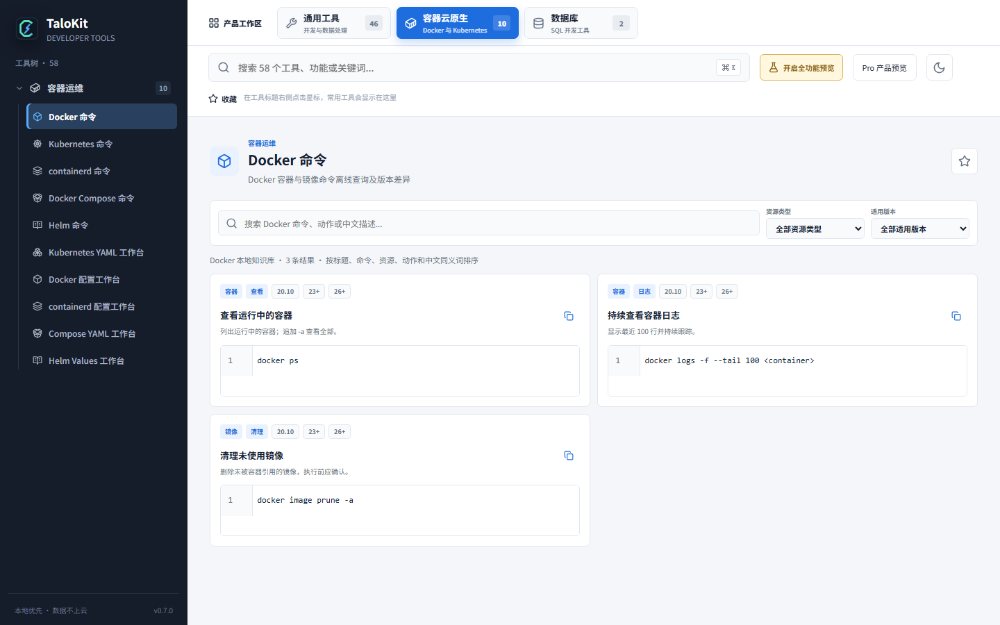

# Docker、Kubernetes、containerd、Compose 与 Helm 命令查询

TaloKit 将常用容器命令整理为本地知识库，目标是比反复搜索网页或向 AI 重述上下文更快地找到可复用命令，并明确参数、版本差异和风险。

## 搜索方式

- 全局搜索：输入完整命令、资源名、参数、中英文别名或故障描述；
- 按资源浏览：容器、镜像、Pod、Deployment、Service、网络、日志等；
- 按操作浏览：创建、查看、调试、复制、删除、清理；
- 按任务生成：根据场景选择参数并生成可复制命令；
- 按版本筛选：查看不同版本的适用性和替代方式。

## 覆盖范围

- Kubernetes 与 kubectl；
- Docker CLI；
- containerd、ctr 和 crictl；
- Docker Compose；
- Helm。

## 安全原则

TaloKit 不执行知识库中的命令。删除、强制覆盖、清理、权限变更等命令会尽量给出风险说明，但提示不能替代操作者审查。

复制命令前请确认：

1. 当前上下文、命名空间和目标主机正确；
2. 参数占位符已替换；
3. 命令与实际软件版本兼容；
4. 写操作、删除操作已有备份或回滚方案。
