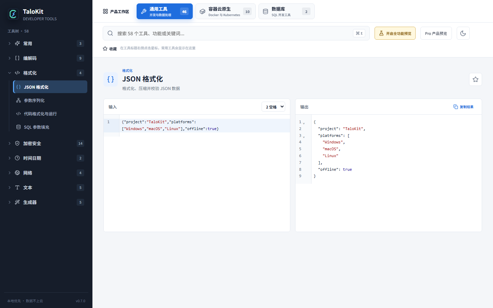

# JSON 格式化、YAML 转换与 Base64 编解码

接口调试时，常见任务并不是编写新代码，而是看清一段响应、定位一个非法字符，或还原一个编码字段。TaloKit 将这些高频操作放在本地桌面工具中。



## JSON 格式化与校验

在顶部搜索框输入 `JSON`，打开工具并粘贴以下内容：

```json
{"product":"TaloKit","localFirst":true,"platforms":["Windows","macOS","Linux"]}
```

执行格式化后，可按层次阅读：

```json
{
  "product": "TaloKit",
  "localFirst": true,
  "platforms": [
    "Windows",
    "macOS",
    "Linux"
  ]
}
```

若输入包含尾逗号、未闭合引号或非法转义，先根据编辑器诊断修正语法，再复制结果。格式化不会替你判断业务字段值是否正确。

### 排错示例：对象键没有双引号

这类内容常来自 JavaScript 对象或手工编辑的配置，它不是合法 JSON：

```text
{name: "demo", "enabled": True,}
```

1. 粘贴到 JSON 工具，根据编辑器的行列提示定位第一个错误。
2. 给 `name` 加双引号，将 `True` 改为小写 `true`，删除最后的尾逗号。
3. 再次格式化或校验，确认得到下面的结果，再交给后续接口使用。

```json
{
  "name": "demo",
  "enabled": true
}
```

JSON 的键必须是双引号字符串，不支持 `//` 注释，也不把单引号当作 JSON 字符串。编辑器报告的位置常是解析器“发现无法继续”的位置，必要时向前检查引号和括号。语法正确不等于符合接口 Schema；必填字段、范围与业务规则仍需按接口契约检查。

## YAML 与 JSON 的差异

同一数据的 YAML 表达可以是：

```yaml
product: TaloKit
localFirst: true
platforms:
  - Windows
  - macOS
  - Linux
```

使用数据转换工具前，留意数字、布尔值、日期与字符串的类型。YAML 注释、锚点和样式不一定能在 JSON 中原样保留；转换后应检查关键字段。

## Base64 编码与解码

在全局搜索中输入 `Base64`，选择编码或解码方向：

| 操作 | 输入 | 输出 |
| --- | --- | --- |
| 编码 | `TaloKit` | `VGFsb0tpdA==` |
| 解码 | `VGFsb0tpdA==` | `TaloKit` |

Base64 适合文本传输和开发调试，**不能隐藏内容，也不能替代加密**。中文内容出现乱码时，应检查原始字符集，而不是反复编码。

### 操作步骤与常见错误

1. 打开 Base64 工具，先确认方向为“编码”还是“解码”。
2. 用表中的 `TaloKit` 示例验证方向，再替换为自己的文本。
3. 若解码输出看似乱码，确认原始数据是否真的是 UTF-8 文本；图片或压缩文件的字节不能直接按普通文本阅读。

| 现象 | 应检查什么 |
| --- | --- |
| 输入包含 `data:image/png;base64,` | 这是 Data URL 前缀，按工具输入要求仅取逗号后的编码内容 |
| JWT 中的 `-`、`_` 或缺少 `=` | JWT 使用 Base64URL，与标准 Base64 字母表、填充规则不同；优先使用 JWT 对应工具 |
| 相同文字的编码不相同 | 检查隐藏换行、前后空格和字符编码；不要直接对业务内容执行去空白 |
| 编码后仍能还原敏感信息 | 这是预期行为；需要保密时应选择合适的加密与密钥管理方案 |

不要把未经确认的解码结果当成可执行脚本。本文示例是普通文本，不包含真实凭据。

## 相关工具

- URL 编解码：处理查询参数中的空格、中文和保留字符；
- Unicode / Hex：检查字符和字节表示；
- Hash：计算摘要并核对内容一致性；
- [文本 Diff](sql-and-diff.md)：比较格式化、转换前后的变化；
- [隐私说明](privacy.md)：了解本地处理和联网场景。

[下载 TaloKit](https://www.talokit.com/#downloads) · [返回功能地图](features.md)

[教程索引](tutorials.md) · [安装说明](getting-started.md) · [常见问题](faq.md) · [问题反馈](https://github.com/maningphp/talokit/issues)
