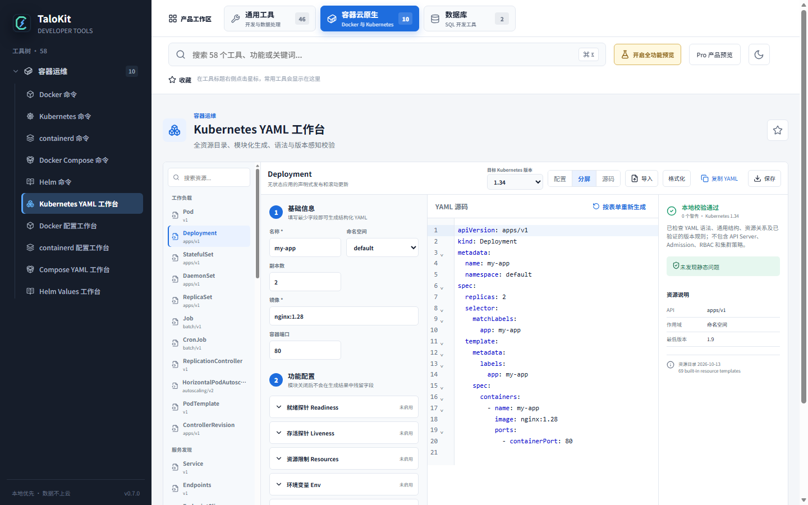

# Kubernetes YAML 生成与校验工作台

TaloKit Kubernetes YAML 工作台面向需要快速起草、检查和学习 Kubernetes 资源清单的开发者与运维工程师。它把资源选择、结构化配置、源码编辑、静态校验和版本差异放在同一界面中。

## 典型用途

- 为 Deployment、StatefulSet、DaemonSet、Job、CronJob 生成配置草稿；
- 配置 Service、Ingress、ConfigMap、Secret、PV、PVC、StorageClass；
- 编写 RBAC、NetworkPolicy、PDB、HPA 等资源；
- 检查 YAML 语法、基础字段结构和资源间常见关系；
- 按目标 Kubernetes 版本识别已废弃或移除的 API；
- 在编辑器中根据行列定位问题并修正。

## 建议工作流

1. 选择目标 Kubernetes 版本和资源类型。
2. 在基础信息与功能配置中填写必要字段。
3. 切换到源码视图，检查生成的 YAML。
4. 查看底部诊断和问题详情，逐项处理错误与警告。
5. 导出前结合目标集群的 CRD、Admission Policy、命名规范和安全策略复核。

## 静态校验能发现什么

- YAML 解析、缩进和多文档结构问题；
- 已知资源的必填字段和字段类型问题；
- selector 与 labels 等常见一致性问题；
- 部分 Ingress、Secret、PVC 和 API 版本兼容问题；
- 常见工程配置遗漏。

## 能力边界

静态校验不能完整模拟 API Server、CRD Schema、准入控制器、云厂商扩展或组织策略。生成结果不是“保证可以直接上线”的证明。正式应用前建议执行对应版本的服务端 dry-run、策略检查和变更评审。

命令知识库只提供命令说明和复制，不自动执行 kubectl 命令。

## 继续阅读

[JSON / YAML 基础示例](json-and-base64.md) · [教程计划](tutorials.md) · [完整功能地图](features.md) · [官方下载](https://www.talokit.com/#downloads) · [隐私说明](privacy.md) · [问题反馈](https://github.com/maningphp/talokit/issues)
