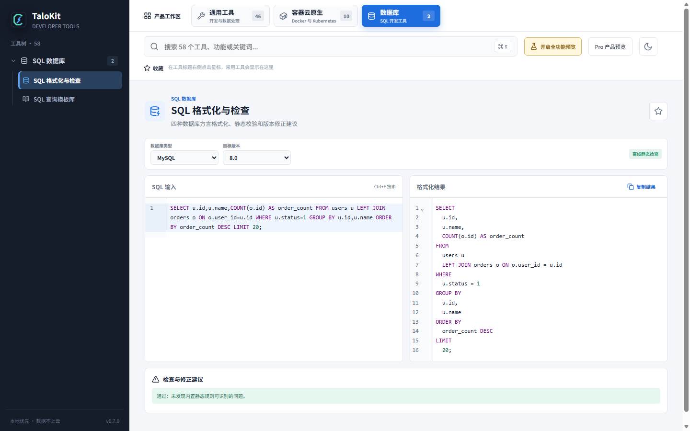
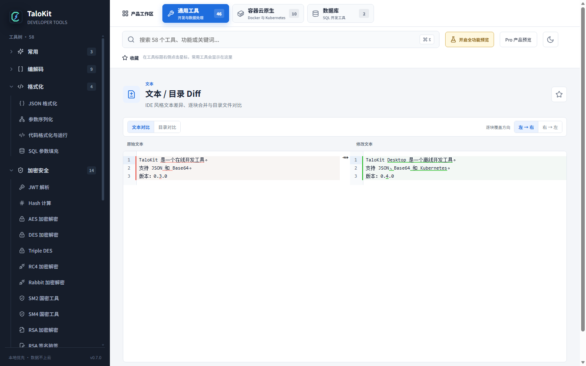

# SQL 工具、文本 Diff 与目录比较

## SQL 格式化与静态检查

TaloKit 支持 MySQL、PostgreSQL、SQLite 和 SQL Server 常用方言。可格式化长 SQL、调整关键字样式、提示高风险语句，并提供分页、Upsert、递归查询等知识模板。

### 使用建议

1. 选择与目标数据库一致的方言和版本。
2. 粘贴 SQL 并执行格式化或检查。
3. 根据行号查看错误、风险与兼容性提示。
4. 复制修正结果前人工核对表名、字段、参数和业务条件。

静态分析不能访问真实 Schema、索引、权限和统计信息，也不会验证事务行为。涉及生产数据的语句必须在隔离环境测试。

## 文本与文件 Diff

双栏编辑器显示行级和行内差异，可跳转到上一处/下一处差异，并按差异块覆盖另一侧。适合配置审查、生成结果对比和小规模文件合并。

## 目录比较

目录模式分别展示左右目录树，标记仅左侧、仅右侧、内容不同和相同文件。打开差异文件后可在独立比较界面处理内容，返回目录视图刷新状态。

覆盖文件前应确认目标路径和方向。重要目录建议先备份，尤其是批量处理配置和脚本时。
